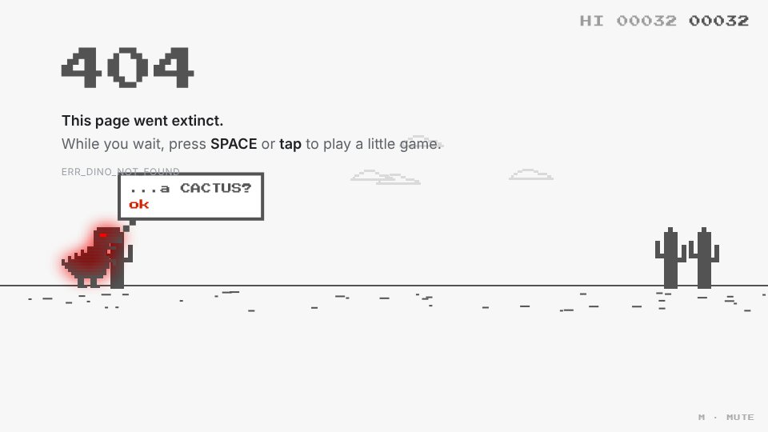
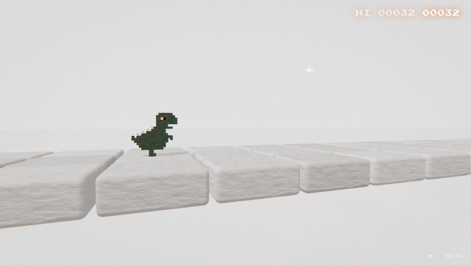
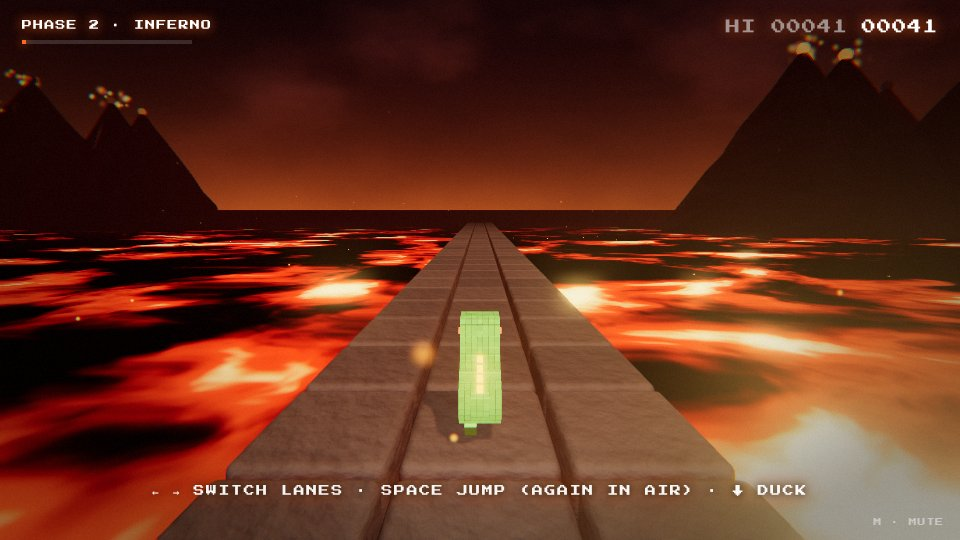
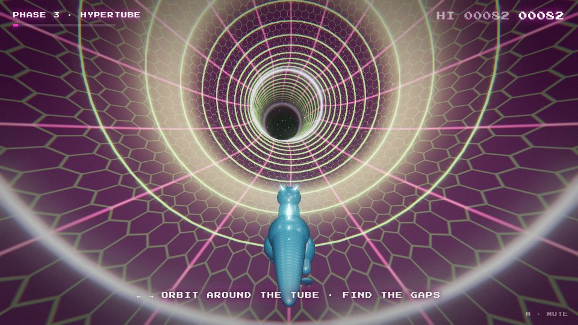
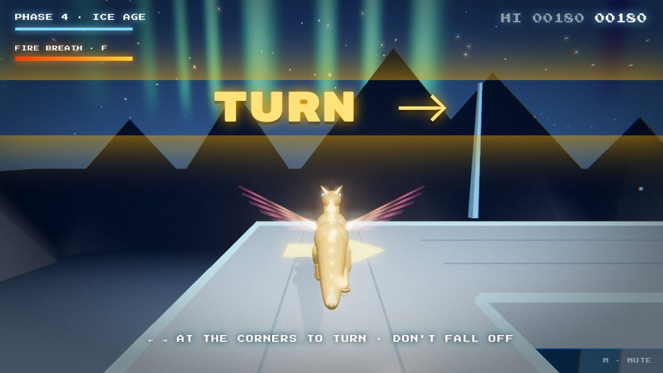
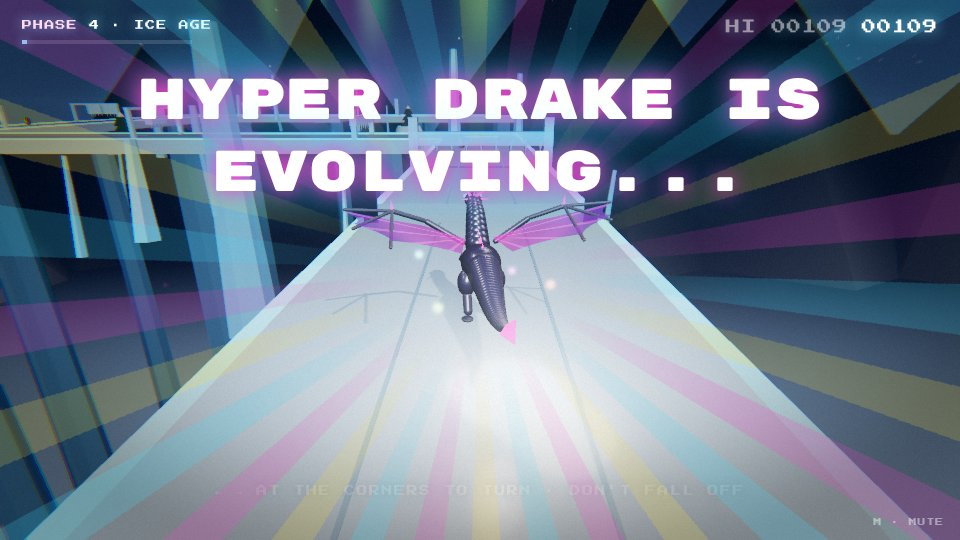

# 404: Dino Not Found

**It looks like the offline dino game. It is not the offline dino game.**

 

You open a "page not found" screen and play the little dino runner while you wait. About twenty seconds in, the dino hits a cactus, the page cracks, and the whole thing falls into 3D. From there every phase gets bigger, faster and stranger, all the way to a boss fight on the ice.

## The phases

| | Phase | What happens |
|---|---|---|
| 1 | **404** | The classic grey runner. Jump the cactuses. Enjoy it while it lasts. |
| 2 | **INFERNO** | Three lanes of stone over a sea of lava, erupting volcanoes, jump, double jump and duck. |
| 3 | **HYPERTUBE** | A neon tunnel you orbit around, curves, spinning gates, then the hyperdrive kicks in. |
| 4 | **ICE AGE** | A frozen track under the northern lights with sharp corners. Your dino evolves into Mega Rex, Hyper Drake and Solar Rex, and gets fire breath. |
| 🧊 | **BOSS: ICE TITAN** | It throws boulders at your lane, sends floor shockwaves and drops icicle rain. You have 3 hearts and fire breath. |

When you win you get a victory cinematic, then **Again, but faster** starts a new loop at double speed (×2, ×4, ×8...).

 
 

## Controls

| | Keyboard | Phone |
|---|---|---|
| Jump | `Space` / `↑` | Tap |
| Duck | `↓` | Swipe down |
| Change lane / orbit / turn | `←` `→` | Swipe left / right |
| Fire breath (when charged) | `F` | 🔥 button |
| Mute | `M` | |

**Secret level select:** type `222`, `333` or `444`, or tap the score 2, 3 or 4 times.

## Under the hood

- One single `index.html`. No build step, no assets, everything is drawn in code.
- 3D with [three.js](https://threejs.org) plus bloom. Sound and music are generated live with the Web Audio API.
- Works on desktop and mobile, in landscape and portrait.

Run it locally by opening `index.html` in a browser, or with `python3 -m http.server`.

## More games in the series

| | |
|---|---|
| 🦖 **404: Dino Not Found** | you are here |
| 👾 [**INVASION '78**](https://github.com/jeniaka/CrazySpaceShip) | a 1978 space shooter that turns into a 3D boss fight · [play](https://invasion78.pages.dev) |
| 🤖 [**MUNCHBOT '80**](https://github.com/jeniaka/pacman) | a 1980 maze chase that becomes a crime city, a first-person shooter and a jungle platformer · [play](https://crazy-pacman.pages.dev) |

Built by <a href="https://github.com/jeniaka">jeniaka</a> with Claude

